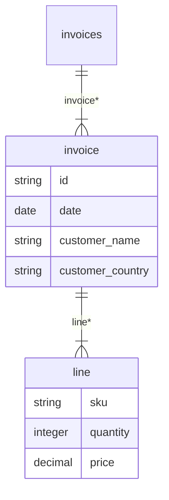

# Load XML into a SQL database with Python

`xml2db` is a Python package that parses and loads XML files into a relational database:

* it automatically maps an XSD schema to a set of tables in the database
* it can handle complex XML files which cannot be denormalized into flat tables
* it works out of the box, without any custom mapping rules, while still configurable.

`xml2db` fits naturally into an [ELT (Extract, Load, Transform)](https://docs.getdbt.com/terms/elt) pipeline: it
loads all the content of XML files into tables that stay close to the source, and the transformations happen later,
in the database.

See the [Getting started](getting_started.md) guide for installation and the Python API, and the
[command line reference](cli.md) for all commands.

## From XML to tables

Take this file, where each invoice has a customer and repeated lines, described by an XSD schema:

??? example "invoices.xsd"

    ``` xml
    <?xml version="1.0" encoding="UTF-8"?>
    <xs:schema xmlns:xs="http://www.w3.org/2001/XMLSchema">
      <xs:element name="invoices">
        <xs:complexType>
          <xs:sequence>
            <xs:element name="invoice" maxOccurs="unbounded">
              <xs:complexType>
                <xs:sequence>
                  <xs:element name="customer">
                    <xs:complexType>
                      <xs:sequence>
                        <xs:element name="name" type="xs:string"/>
                        <xs:element name="country" type="xs:string"/>
                      </xs:sequence>
                    </xs:complexType>
                  </xs:element>
                  <xs:element name="line" maxOccurs="unbounded">
                    <xs:complexType>
                      <xs:sequence>
                        <xs:element name="sku" type="xs:string"/>
                        <xs:element name="quantity" type="xs:integer"/>
                        <xs:element name="price" type="xs:decimal"/>
                      </xs:sequence>
                    </xs:complexType>
                  </xs:element>
                </xs:sequence>
                <xs:attribute name="id" type="xs:string" use="required"/>
                <xs:attribute name="date" type="xs:date" use="required"/>
              </xs:complexType>
            </xs:element>
          </xs:sequence>
        </xs:complexType>
      </xs:element>
    </xs:schema>
    ```

``` xml title="invoices.xml"
<invoices>
  <invoice id="INV-001" date="2026-10-01">
    <customer><name>Alice</name><country>FR</country></customer>
    <line><sku>X1</sku><quantity>2</quantity><price>9.90</price></line>
    <line><sku>Y7</sku><quantity>1</quantity><price>24.00</price></line>
  </invoice>
  <invoice id="INV-002" date="2026-10-02">
    <customer><name>Bob</name><country>DE</country></customer>
    <line><sku>X1</sku><quantity>2</quantity><price>9.90</price></line>
  </invoice>
</invoices>
```

A single command, with no mapping to write:

``` bash
xml2db import invoices.xml invoices.xsd --connection-string "duckdb:///invoices.duckdb"
```

gives an `invoice` table, a `line` table and an `invoice_line` table linking them, plus tables for the `invoices` root
element. The `customer` element has a single occurrence, so its fields become columns of `invoice`. The `X1` line appears twice in the file but is stored once.

=== "invoice"

    | pk_invoice | id      | date       | customer_name | customer_country |
    |-----------:|---------|------------|---------------|------------------|
    | 1          | INV-001 | 2026-10-01 | Alice         | FR               |
    | 2          | INV-002 | 2026-10-02 | Bob           | DE               |

=== "line"

    | pk_line | sku | quantity | price |
    |--------:|-----|---------:|------:|
    | 1       | X1  | 2        | 9.9   |
    | 2       | Y7  | 1        | 24.0  |

=== "invoice_line"

    | fk_invoice | fk_line |
    |-----------:|--------:|
    | 1          | 1       |
    | 1          | 2       |
    | 2          | 1       |

The tables are then queried with plain SQL joins:

``` sql
SELECT i.id, i.customer_name, l.sku, l.quantity, l.price
FROM invoice i
JOIN invoice_line il ON il.fk_invoice = i.pk_invoice
JOIN line l ON l.pk_line = il.fk_line;
```

## Load first, transform later

Parsing XML is slow compared to running SQL on tables already in a database. Since `xml2db` loads every element and
attribute, you do not need to decide upfront which data to extract and how to reshape it:

* explore the loaded tables with SQL before choosing transformations;
* when a new question comes, or the transformation logic changes, rerun the SQL on the loaded tables;
* keep the `xml2db` tables as a raw layer, and build the tables people query on top of them with
  [dbt](dbt.md), SQL views or stored procedures.

The same applies when the final tables live elsewhere: load into [DuckDB](databases/duckdb.md), transform with SQL,
then [export the result](databases/export.md) to files, lakehouse tables or other databases.

## When to use xml2db

Many XML files do not need `xml2db`. The table below compares it with common alternatives.

| Situation | Usually enough | What xml2db adds |
|---|---|---|
| A few fields from flat, record-like XML | `pandas.read_xml`, a short `lxml` script, or the XML functions of your database | Little: these are simpler |
| One repeated record element with shallow nesting | XML readers that turn each record into a row, such as Spark's XML data source or DuckDB XML extensions | Normalized tables, with no nested columns to explode |
| Deep nesting, repeated elements at several levels, large XSD | Hand-written mappings, one per element | Tables, keys and loading code generated from the XSD, no mapping to maintain |
| Recurring feed of files following the same schema | A custom script per feed | The same load for every file, with redundant content stored once |
| Needs not settled yet: which fields, which aggregations | Extracting the fields you expect to need, and parsing the files again when needs change | Everything loaded once: new questions are answered with SQL |
| All the data must be kept, or written back to XML | Hand-written mappings, with the risk of dropping fields | Every element and attribute kept, with a round trip back to XML |

`xml2db` needs an XSD schema. Files are parsed in memory: files around 500 MB work in practice. Recursive schemas,
wildcards and mixed content are only partly supported, see the [caveats](how_it_works.md#caveats).

## Supported backends

Built on `sqlalchemy`, `xml2db` supports multiple database backends. Integration tests cover PostgreSQL, MySQL,
MS SQL Server, and DuckDB. Each backend has its own page with connection strings, bulk loading and configuration
advice:

* [PostgreSQL](databases/postgresql.md)
* [SQL Server](databases/sql-server.md)
* [MySQL and MariaDB](databases/mysql.md)
* [DuckDB](databases/duckdb.md)
* [Files, lakehouses and other databases, through DuckDB](databases/export.md)

To build transformed tables on top of the loaded data, see [Transform with dbt](dbt.md). To only generate
`CREATE TABLE` statements from an XSD, see [XSD to SQL tables](xsd-to-sql.md).

## Visualising data models

`xml2db` generates visual diagrams of your data model directly from an XSD file, using
[Mermaid](https://mermaid.js.org/syntax/entityRelationshipDiagram.html) to represent tables and their relationships. You can see this representation and others
through the interactive configuration panel in your browser (`xml2db serve`).

For the invoices schema above, it looks like this:



Each box is a table with its columns and XSD types. The asterisk on `line*` means that a relationship table,
`invoice_line`, links the two tables, since a line can be shared by several invoices.

## How to contribute to this project

`xml2db` is developed and used at the [French energy regulation authority (CRE)](https://www.cre.fr/) to process complex
XML data.

Contributions and bug reports are welcome on the project's
[issue page](https://github.com/cre-dev/xml2db/issues).

If you find this package useful, you can give it a star on [`xml2db`'s GitHub repo](https://github.com/cre-dev/xml2db)!
