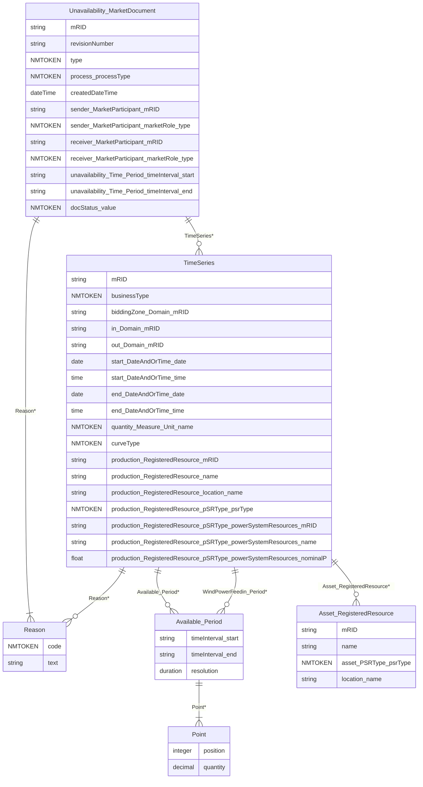

# Loading XML into a relational database

`xml2db` is a Python package that parses and loads XML files into a relational database:

* it automatically maps an XSD schema to a set of tables in the database
* it can handle complex XML files which cannot be denormalized into flat tables
* it works out of the box, without any custom mapping rules, while still configurable.

`xml2db` fits naturally into an ETL or [ELT (Extract, Load, Transform)](https://docs.getdbt.com/terms/elt) pipeline. It loads
XML files into a relational model that stays close to the source data while remaining easy to query as flat database
tables.

The raw data can then be transformed using [DBT](https://www.getdbt.com/), SQL views, or stored procedures to produce
more user-friendly tables.

See the [Getting started](getting_started.md) guide for installation, CLI usage, and the Python API.

## From XML to tables

Take this XSD-described file, where each invoice has a customer and repeated lines:

``` xml title="invoices.xml"
<invoices>
  <invoice id="INV-001" date="2026-10-01">
    <customer><name>Alice</name><country>FR</country></customer>
    <line><sku>X1</sku><quantity>2</quantity><price>9.90</price></line>
    <line><sku>Y7</sku><quantity>1</quantity><price>24.00</price></line>
  </invoice>
  <invoice id="INV-002" date="2026-10-02">
    <customer><name>Bob</name><country>DE</country></customer>
    <line><sku>X1</sku><quantity>2</quantity><price>9.90</price></line>
  </invoice>
</invoices>
```

A single command, with no mapping to write:

``` bash
xml2db import invoices.xml invoices.xsd --connection-string "duckdb:///invoices.duckdb"
```

gives an `invoice` table, a `line` table and an `invoice_line` table linking them, plus tables for the `invoices` root
element. The `customer` element has a single occurrence, so its fields become columns of `invoice`. The `X1` line appears twice in the file but is stored once.

=== "invoice"

    | pk_invoice | id      | date       | customer_name | customer_country |
    |-----------:|---------|------------|---------------|------------------|
    | 1          | INV-001 | 2026-10-01 | Alice         | FR               |
    | 2          | INV-002 | 2026-10-02 | Bob           | DE               |

=== "line"

    | pk_line | sku | quantity | price |
    |--------:|-----|---------:|------:|
    | 1       | X1  | 2        | 9.9   |
    | 2       | Y7  | 1        | 24.0  |

=== "invoice_line"

    | fk_invoice | fk_line |
    |-----------:|--------:|
    | 1          | 1       |
    | 1          | 2       |
    | 2          | 1       |

The tables are then queried with plain SQL joins:

``` sql
SELECT i.id, i.customer_name, l.sku, l.quantity, l.price
FROM invoice i
JOIN invoice_line il ON il.fk_invoice = i.pk_invoice
JOIN line l ON l.pk_line = il.fk_line;
```

## When to use xml2db

Many XML files do not need `xml2db`. The table below compares it with common alternatives.

| Situation | Usually enough | What xml2db adds |
|---|---|---|
| A few fields from flat, record-like XML | `pandas.read_xml`, a short `lxml` script, or the XML functions of your database | Little: these are simpler |
| One repeated record element with shallow nesting | XML readers that turn each record into a row, such as Spark's XML data source or DuckDB XML extensions | Normalized tables instead of nested columns to explode |
| Deep nesting, repeated elements at several levels, large XSD | Hand-written mappings, one per element | Tables, keys and loading code generated from the XSD, no mapping to maintain |
| Recurring feed of files following the same schema | A custom script per feed | The same load for every file, with redundant content stored once |
| All the data must be kept, or written back to XML | Hand-written mappings, with the risk of dropping fields | Every element and attribute kept, with a round trip back to XML |

`xml2db` needs an XSD schema. Files are parsed in memory: files around 500 MB work in practice. Recursive schemas,
wildcards and mixed content are only partly supported, see the [caveats](how_it_works.md#caveats).

## Supported backends

Built on `sqlalchemy`, `xml2db` supports multiple database backends. Integration tests cover PostgreSQL, MySQL,
MS SQL Server, and DuckDB. Each backend has its own page with connection strings, bulk loading and configuration
advice:

* [PostgreSQL](databases/postgresql.md)
* [SQL Server](databases/sql_server.md)
* [MySQL and MariaDB](databases/mysql.md)
* [DuckDB](databases/duckdb.md)
* [SQLite, Parquet, Delta Lake and other targets through DuckDB](databases/other_targets.md)

To only generate `CREATE TABLE` statements from an XSD, see [XSD to SQL tables](xsd_to_sql.md).

## Visualising data models

`xml2db` generates visual diagrams of your data model directly from an XSD file, using
[Mermaid](https://mermaid.js.org/syntax/entityRelationshipDiagram.html) to represent tables and their relationships. You can see this representation and others
through the interactive configuration panel in your browser (`xml2db serve`).

It looks like this:



## How to contribute to this project

`xml2db` is developed and used at the [French energy regulation authority (CRE)](https://www.cre.fr/) to process complex
XML data.

Contributions and bug reports are welcome on the project's
[issue page](https://github.com/cre-dev/xml2db/issues).

If you find this package useful, you can give it a star on [`xml2db`'s GitHub repo](https://github.com/cre-dev/xml2db)!
